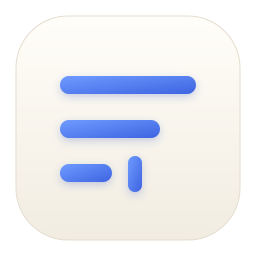
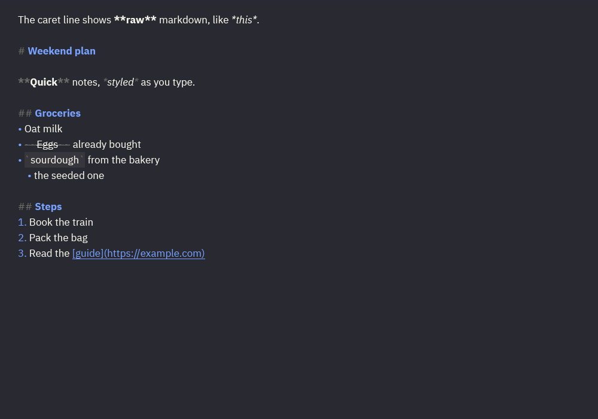

<p align="center">
  
</p>

<h1 align="center">Scratchpad</h1>

<p align="center">
  A floating markdown scratchpad for Linux and macOS, in the style of Raycast Notes.<br>
  Native <a href="https://www.gpui.rs/">GPUI</a> app, one file, no accounts, no sync.
</p>



Hit a hotkey, jot something down, hit it again. The window closes and the text is already saved.

## What it does

- **One note, always saved.** Every change is written to `~/Documents/scratchpad.md` as you type. Open it in any editor.
- **Live markdown styling.** Headings, **bold**, *italic*, `~~strikethrough~~`, `` `code` `` and links are styled while you write. Markers (`#`, `~~`, backticks) are dimmed on every line except the one with the caret, so raw markdown shows only where you are editing.
- **Lists that behave.** Typing `- ` turns into a `•` bullet. Enter continues the list (bullets and `1.` numbering), and Enter on an empty item ends it. Tab and Shift+Tab indent and outdent a bullet. Bullet and number markers are tinted with the accent color.
- **Copy on select.** Selecting text copies it, like a terminal. It stays available after the app closes. On Linux it goes to both Wayland clipboards (regular and primary), so it pastes in terminals with Shift+Insert.
- **Copies markdown.** Copy, cut and copy on select turn `•` bullets back into `- `.
- **Remembers its place.** Window size and position are saved and restored (on Linux through Hyprland and `hyprctl`).
- **Toggle from anywhere (macOS).** Opt+V shows the window above other apps, and hides it again. Cmd+W hides it; the app keeps running.
- **Translucent, dark.** Claude-black background with an orange accent, in IBM Plex Sans.

## Build

```sh
cargo build --release
```

Platform code lives in `src/linux.rs` and `src/macos.rs`; `src/main.rs` is shared.

On macOS, install the font with `brew install --cask font-ibm-plex-sans`. Run `macos/bundle.sh` to build `target/release/Scratchpad.app`, which gives the Dock its name and icon, or `macos/bundle.sh --install` to put it in `/Applications`. The script signs the app with your Apple Development identity if you have one, so macOS remembers the Documents access grant across rebuilds. Without one it signs ad-hoc, and macOS asks again after each rebuild. Run it from a GUI terminal the first time, so the keychain can ask to use the identity.

On Linux, it needs a Wayland session with `wl-copy` (from `wl-clipboard`) for copy on select. Window position tracking needs Hyprland. The font is set by `FONT` in `src/main.rs` and must be installed. Use a font with static Bold and Italic files (on Arch, `ttf-ibm-plex`): GPUI does not apply variable-font axes, so a variable font shows no bold or italic.

## Run

```sh
target/release/scratchpad
```

On macOS, open `Scratchpad.app` instead and use Opt+V to toggle it.

On Linux, it works best behind a toggle key that starts the app, or closes the window if it is already open. The window class is `scratchpad`, so a Hyprland rule such as `float` and `pin` for that class gives the Raycast feel.

## Edit keys

macOS uses the standard macOS edit keys. On Linux, ALT stands in for CTRL for word movement, deletion, select all and undo (`alt-left`, `alt-backspace`, `alt-a`, `alt-z`, and so on), because ALT+C/V/X are Hyprland binds on the author's setup. `ctrl-insert` and `shift-insert` copy and paste.

## License

MIT
